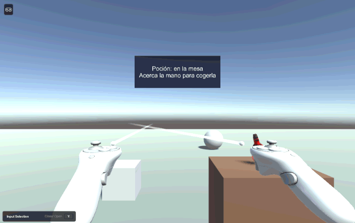
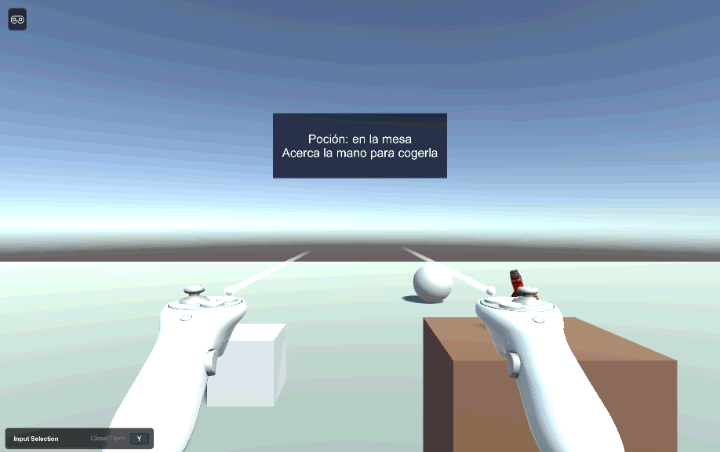

# Práctica 5.2 — XR Interaction Toolkit

Interfaces Inteligentes · Unity 6000.6.5f1 · XR Interaction Toolkit 3.6.1 · OpenXR 1.18

Los scripts están en [`Scripts/`](Scripts) y las pruebas de ejecución en [`gifs/`](gifs).

## Instalación y configuración

**Paquetes** (Package Manager):

1. XR Plugin Management (`com.unity.xr.management` 4.7.0)
2. OpenXR Plugin (`com.unity.xr.openxr` 1.18.0)
3. XR Interaction Toolkit (`com.unity.xr.interaction.toolkit` 3.6.1), con los *Samples*:
   - **Starter Assets**: el XR Origin y los interactores ya configurados.
   - **XR Interaction Simulator**: el simulador genérico del XR Interaction Toolkit.

El toolkit usa el Input System nuevo, así que en *Player → Active Input Handling* está
puesto **Both**.

**OpenXR** (en *XR Plug-in Management*):

| Plataforma | Proveedor | *Initialize XR on Startup* | Perfiles de interacción |
|---|---|---|---|
| Standalone (Windows) | OpenXR | No | Oculus Touch Controller Profile, Meta Quest Touch Plus Controller Profile |
| Android (Quest) | OpenXR | Sí | Oculus Touch Controller Profile, Meta Quest Touch Plus Controller Profile, Meta Quest Support |

El perfil *Oculus Touch* corresponde a los mandos de Quest 2 y el *Meta Quest Touch Plus* a los
de Quest 3 / 3S.

### Simulador

Se ha usado el **XR Interaction Simulator** del XR Interaction Toolkit. El enunciado permite usar
este simulador genérico en lugar del Meta XR Simulator. Este simulador no necesita instalar nada
fuera de Unity, y el mismo XR Origin sirve luego para unas gafas reales.

El simulador está en la escena como el objeto `XR Interaction Simulator`. Como pide el
enunciado, se activa o desactiva según se use o no: en Standalone, *Initialize XR on Startup* está
desactivado para que OpenXR no intente arrancar unas gafas y el simulador cree los dispositivos
simulados. Para probar con unas Quest habría que desactivar el objeto del simulador y compilar para
Android.

Controles del simulador que se ven en los gifs:

| Acción | Tecla |
|---|---|
| Moverse (cuerpo) | WASD |
| Girar la cabeza | Flechas, o botón derecho + ratón |
| Cambiar entre mover el cuerpo o solo el mando | Tab |
| Subir / bajar el mando | E / Q |
| Apuntar el mando y agarrar (grip) | Clic izquierdo (apunta a donde está el ratón) |
| Mover el mando izquierdo / derecho | `[` / `]` |

## La escena

Escena `InteraccionXR`, montada siguiendo los pasos del enunciado:

1. **Se elimina la Main Camera**, porque el XR Origin trae su propia cámara, la que sigue la cabeza.
2. **XR Origin (XR Rig)** de los Starter Assets. La altura de la cámara (*Camera Y Offset*) es 1,6 m.
3. **Locomoción**: el XR Origin de los Starter Assets ya trae el *Locomotion Mediator*, el
   *Teleportation Provider* y el movimiento continuo con el joystick. En el simulador uno se
   mueve con WASD.
4. **Objetos interactuables** sobre un plano y a distintas distancias del jugador:
   - un **cubo** a unos 3 m, a la izquierda;
   - una **esfera** a unos 7 m, a la derecha;
   - una **poción** (`Bottle_Health` del paquete
     [Potions, Coin And Box of Pandora Pack](https://assetstore.unity.com/packages/3d/props/potions-coin-and-box-of-pandora-pack-71778)
     de la Asset Store) sobre una mesa, a 1,3 m.

Los tres objetos tienen los tres componentes de la tabla del enunciado:

| Componente | Qué aporta |
|---|---|
| Collider | Hace que los interactores lo detecten |
| Rigidbody | Física: cae al soltarlo |
| XR Grab Interactable | Lo marca como agarrable y lanza los eventos de selección |

A la poción se le han desactivado los brillos de partículas que trae el prefab, porque tapaban la
vista.

Además hay un **panel de UI** (un Canvas en *World Space* con un `Text`) flotando detrás de la
mesa. En realidad virtual no se usa un Canvas en *Screen Space*, porque no se vería bien en las dos
lentes.

### Interactores de cada mando

El XR Origin de los Starter Assets (XRI 3.x) trae en cada mando un *Near-Far Interactor*, que
hace a la vez de rayo y de mano. Para usar los dos interactores que pide el enunciado, en cada mando
se ha **desactivado el Near-Far Interactor** y se han añadido los prefabs de los Starter Assets:

- **Ray Interactor** (`XRRayInteractor`): lanza un rayo recto de hasta 15 m y dibuja la línea
  azul. Detecta los interactuables por *raycast*.
- **Direct Interactor** (`XRDirectInteractor`): una esfera de 10 cm en la mano. Detecta los
  interactuables por *collider*, así que hay que tocar el objeto.

Las entradas de los dos (seleccionar con el grip y activar con el gatillo) se han copiado de las que
tenía el Near-Far Interactor del mismo mando.

Para que el cubo y la esfera solo se cojan con el rayo y la poción solo con la mano, se usan las
**Interaction Layers** del XR Interaction Toolkit, que no son las capas de Unity. Un interactor
solo puede interactuar con los interactuables que comparten alguna capa con él.

| Interaction Layer | Interactor | Interactuables |
|---|---|---|
| 1 `Rayo` | Ray Interactor | Cubo, Esfera |
| 2 `Directo` | Direct Interactor | Poción |
| 31 `Teleport` | Teleport Interactor | (la reservan los Starter Assets) |

Así, aunque el rayo pase por encima de la poción, no la coge. Y aunque la mano toque el cubo,
tampoco lo coge.

## Ray Interactor: el cubo y la esfera cambian de color

Script: [`CambiarColorAlSeleccionar.cs`](Scripts/CambiarColorAlSeleccionar.cs)



El script va en el cubo y en la esfera. Busca su `XRGrabInteractable` y se suscribe a su evento
`selectEntered`, que el toolkit lanza cuando un interactor selecciona el objeto:

```csharp
void OnEnable()
{
    interactuable.selectEntered.AddListener(AlSeleccionar);
}

void AlSeleccionar(SelectEnterEventArgs args)
{
    indice = (indice + 1) % colores.Length;
    render.material.color = colores[indice];
}
```

Cada vez que se selecciona, el objeto pasa al siguiente color de la lista (rojo, verde, azul,
amarillo y magenta). En `OnDisable` se quita la suscripción con `RemoveListener`. El
`args.interactorObject` dice qué interactor lo ha seleccionado; se escribe en la consola.

En el gif se apunta con el ratón al cubo y se hace clic. El simulador gira el mando derecho hacia
el cubo y aprieta el grip, el rayo lo selecciona y el cubo se vuelve rojo. Mientras se mantiene
el clic, el cubo sigue al rayo, y al soltarlo cae por su Rigidbody. Luego pasa lo mismo con la
esfera, que está más lejos. Al seleccionar cada objeto una segunda vez cambian a verde.

## Direct Interactor: la poción actualiza la UI al agarrarla

Script: [`ActualizarUIAlAgarrar.cs`](Scripts/ActualizarUIAlAgarrar.cs)



El script va en la poción y tiene una referencia al `Text` del panel. Se suscribe a dos eventos
del `XRGrabInteractable`:

- `selectEntered` (al agarrarla): el texto pasa a "Poción agarrada con la mano derecha", se pone
  en verde y cuenta las veces que se ha agarrado.
- `selectExited` (al soltarla): el texto pasa a "Poción soltada" y vuelve a blanco.

Para saber con qué mano se ha cogido, se mira el nombre del objeto padre del interactor
(`Left Controller` o `Right Controller`).

En el gif el jugador gira la cabeza hacia la mesa y anda hasta ella con WASD. Luego mira hacia
abajo, pulsa Tab para mover solo el mando derecho y lo acerca a la poción con WASD/QE. Al hacer
clic se aprieta el grip: la esfera del Direct Interactor está tocando la poción, así que la coge y
el panel se actualiza. Con la poción en la mano vuelve a mover el cuerpo y mira el panel. Al soltar
el clic, la poción cae al suelo y el panel muestra "Poción soltada".
